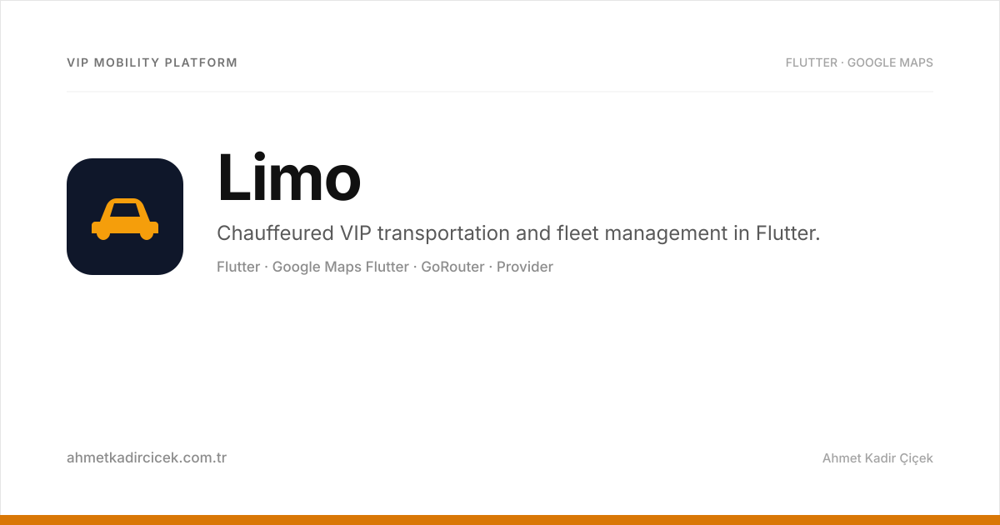

# Limo — Professional Transportation Solutions

<div align="center">



### VIP chauffeured transfer booking, fleet dispatching, and real-time navigation.

[](https://flutter.dev)
[](https://dart.dev)
[](https://pub.dev/packages/provider)
[](https://pub.dev/packages/google_maps_flutter)
[](https://pub.dev/packages/go_router)
[](https://pub.dev/packages/encrypt)

<br/>

<p align="center">
  
  &nbsp;&nbsp;&nbsp;&nbsp;
  
</p>

</div>

---

## 🚗 Overview

**Limo** is an enterprise-grade mobile application built with Flutter tailored for premium chauffeured transfer services and executive fleet operators. It addresses the end-to-end lifecycle of VIP passenger transit: from instant ride booking with precise waypoint routing to fleet vehicle qualification, document compliance verification, and live turn-by-turn tracking.

Designed for luxury transport companies, corporate fleets, and airport transfer services, Limo provides both drivers and operators with a unified, high-reliability mobile workflow.

---

## ✨ Features

- **Executive Ride Booking & Dispatch**: Create and manage chauffeured transfer requests with multi-stop itineraries, passenger manifests, and flight arrival tracking.
- **Interactive Google Maps Integration**: Custom-styled luxury dark map themes, live GPS telemetry, distance matrix calculations, and polyline route previews via Google Directions API.
- **Fleet & Vehicle Registration**: Driver profile validation, vehicle classification (Sedan, Luxury Van, Executive SUV), plate registration, and maintenance log tracking.
- **Document & License Verification**: In-app camera and gallery document ingestion with client-side image compression and secure encrypted payload transport.
- **State Management & Decoupled Routing**: Clean state distribution via `provider` and declarative route hierarchies using `go_router`.
- **End-to-End Payload Security**: Sensitive ride and financial data encrypted with AES-256 via the `encrypt` package.

---

## 🏛️ Project Architecture

```
lib/
├── core/                 # Cross-cutting foundational modules
│   ├── navigation/       # GoRouter declarative router & auth guards
│   ├── providers/        # App-level StateProviders (CarProvider, AuthProvider)
│   ├── services/         # Network, Google Maps, Geocoding, Encryption, Storage
│   └── theme/            # Luxury dark & light palettes, typography tokens
├── module/               # Feature-specific modules
│   ├── address_picker/   # Google Places search sheet & interactive pin dropper
│   ├── car_management/   # Fleet vehicle list, specs & status indicators
│   ├── car_registration/# Vehicle onboarding, license input & photo upload
│   ├── job_create/       # New transfer order creation & vehicle requirement selector
│   ├── job_details/      # Route overview, pickup timeline & passenger information
│   ├── jobs/             # Active, upcoming, and past dispatch history
│   ├── profile/          # Driver identity, licenses & business credentials
│   └── splash/           # Initialization, token validation & session restore
└── shared/               # Shared constants, enums, formatters, and reusable widgets
```

---

## 🚀 Getting Started

### Prerequisites
- Flutter SDK `^3.7.0` (Dart `^3.7.0`)
- Valid Google Maps Platform API Key (Directions API, Places API, Geocoding API enabled)
- Xcode 15+ / Android Studio Hedgehog+

### Installation & Run

```bash
# 1. Clone the repository
git clone https://github.com/ahmetkadircicek/limo.git
cd limo

# 2. Install Flutter packages
flutter pub get

# 3. Configure Google Maps Key
# Place your Google Maps API key in android/app/src/main/AndroidManifest.xml
# and ios/Runner/AppDelegate.swift

# 4. Launch the application
flutter run
```

---

## 👨‍💻 Author

**Ahmet Kadir Çiçek**
- Website: [ahmetkadircicek.com.tr](https://ahmetkadircicek.com.tr)
- GitHub: [@ahmetkadircicek](https://github.com/ahmetkadircicek)
- LinkedIn: [in/akadircicek](https://www.linkedin.com/in/akadircicek)

---

## 📄 License

Proprietary software. All rights reserved © Ahmet Kadir Çiçek.
